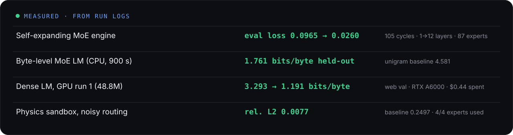

  

I build and run AI systems end to end: model code, training runs on rented GPUs, and the cloud infrastructure around them. I'm the founder of **Cutline Industries**, where I'm building **[Artemis AI](https://artemisai-bycutlineindustries.studio)**.

### Shipped and measured

- **[Artemis 567885](https://github.com/lpittman-blip/artemis-567885)**: a CPU-first Top-K sparse Mixture-of-Experts transformer in PyTorch with a **self-expanding engine**. It adds experts, layers and capacity when training stalls, and a supervisor rolls back any change that breaks. Over 105 supervised cycles it grew from 1 layer to 12 layers and 87 experts, and eval loss went from 0.0965 to 0.0260. One cycle timed out and rolled back cleanly. Development happens in stacked PRs, and every number has a log.
- **Training on rented GPUs**: a 48.8M-parameter dense Artemis LM trained on 1× RTX A6000 for 50 minutes (374M tokens). Held-out web text went from 3.293 to 1.191 bits/byte, and the Artemis docs from 4.036 to 1.374. Measured spend was $0.44.
- **Fine-tuning pipeline with cost guards**: QLoRA fine-tunes of a 7B model and a 30B model on 2-GPU rented instances. Every run has a hard dollar cap ($5 and $15), a host-side kill timer, an on-instance self-destruct, and teardown verified by instance ID. Real spend was $0.53 and $1.08.
- **Ops dashboard on Azure**: a password-protected, trading-terminal-style dashboard on Azure Container Apps. It uses bcrypt login, signed sessions, a strict CSP, rate limits and Blob-backed daily snapshots, and refreshes every morning. I also built an **Ops Terminal** for it: a sandboxed command API for agents with a JSON in/out format, per-command timeouts, a command policy, rate limits, secret redaction and an audit log.
- **Forge**: a code-hosting platform I'm building the way large Git hosts are built. It has a Rails monolith; Go services for the API gateway, realtime and Git RPC; quorum-based Git ref replication; Rust trigram code search; and a React UI kit.

### Stack

`Python` `PyTorch` `CUDA` `QLoRA / PEFT` · `Node.js` `TypeScript` `React` · `Go` `Rust` `Ruby on Rails` · `Azure Container Apps` `Azure Blob` `Docker` · `Linux` `Bash`

### How I work

Measure first, label estimates, and keep negative results. Every GPU run gets a price cap, a time limit and a verified teardown. Defaults stay off until a test proves the old path still holds.

### What I'm looking for

Roles on **AI training and infrastructure teams**: model and training-systems work, GPU and cluster efficiency, and the tooling that keeps large runs safe and cheap.

  
  

  <a href="https://artemisai-bycutlineindustries.studio">artemisai-bycutlineindustries.studio</a>

