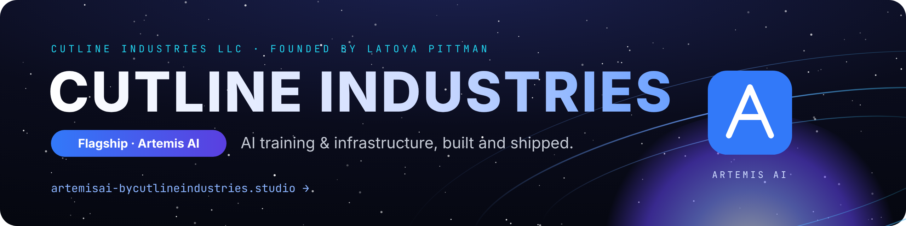
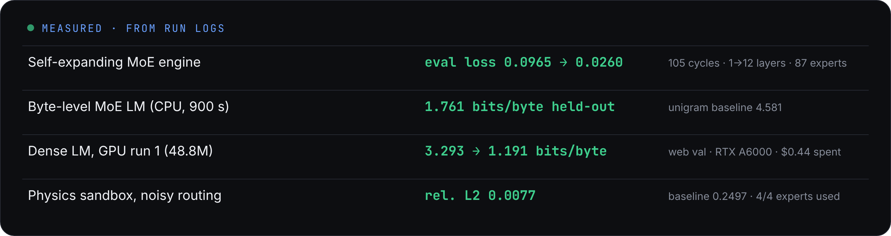

  
  
  

## Cutline Industries LLC

I'm **Latoya Pittman**, founder of **Cutline Industries LLC**. We build AI systems end to end: the model code, the training runs on rented GPUs, and the cloud infrastructure that keeps them safe and cheap. Our flagship is **[Artemis AI](https://artemisai-bycutlineindustries.studio)**.

<table>
  <tr>
    <td width="50%" valign="top">
      <h3>🛰️ Artemis AI <code>flagship</code></h3>
      The Artemis AI website, with chat, products and account pages.  
      
    </td>
    <td width="50%" valign="top">
      <h3>🧠 Artemis 567885 <code>open source</code></h3>
      A self-expanding sparse Mixture-of-Experts engine in PyTorch. It grew from 1 to 12 layers over 115 supervised cycles.  
      
    </td>
  </tr>
  <tr>
    <td width="50%" valign="top">
      <h3>🖥️ Ops Dashboard and Ops Terminal</h3>
      A secured ops dashboard on Azure Container Apps, plus a sandboxed command API for agents with an audit log.
    </td>
    <td width="50%" valign="top">
      <h3>💸 Cost-capped GPU training</h3>
      Every run gets a hard dollar cap, a kill timer, a self-destruct, and teardown verified by instance ID.
    </td>
  </tr>
</table>

### Shipped and measured

- **[Artemis 567885](https://github.com/Cutline-industries/artemis-567885)**: a CPU-first Top-K sparse Mixture-of-Experts transformer in PyTorch with a **self-expanding engine**. It adds experts, layers and capacity when training stalls, and a supervisor rolls back any change that breaks. Over 115 supervised cycles it grew from 1 layer to 12 layers and 93 experts, and eval loss went from 0.0965 to 0.0259. One cycle timed out and rolled back cleanly. Development happens in stacked PRs, and every number has a log.
- **Byte-level language field (no tokenizer)**: raw bytes streamed over HTTP Range plus a Fourier position code, fed through causal MoE blocks. On 1× RTX 4070 it reached **1.662 bits/byte** on held-out text, against 4.619 for a unigram baseline and 2.075 with no position input. Measured spend was $0.03.
- **Training on rented GPUs**: a 48.8M-parameter dense Artemis LM trained on 1× RTX A6000 for 50 minutes (374M tokens). Held-out web text went from 3.293 to 1.191 bits/byte, and the Artemis docs from 4.036 to 1.374. Measured spend was $0.44.
- **Fine-tuning pipeline with cost guards**: QLoRA fine-tunes of a 7B model and a 30B model on 2-GPU rented instances. Every run has a hard dollar cap ($5 and $15), a host-side kill timer, an on-instance self-destruct, and teardown verified by instance ID. Real spend was $0.53 and $1.08.
- **Ops dashboard on Azure**: a password-protected, trading-terminal-style dashboard on Azure Container Apps. It uses bcrypt login, signed sessions, a strict CSP, rate limits and Blob-backed daily snapshots, and refreshes every morning. I also built an **Ops Terminal** for it: a sandboxed command API for agents with a JSON in/out format, per-command timeouts, a command policy, rate limits, secret redaction and an audit log.
- **Forge**: a code-hosting platform I'm building the way large Git hosts are built. It has a Rails monolith; Go services for the API gateway, realtime and Git RPC; quorum-based Git ref replication; Rust trigram code search; and a React UI kit.

### Stack

                

### How I work

Measure first, label estimates, and keep negative results. Every GPU run gets a price cap, a time limit and a verified teardown. Defaults stay off until a test proves the old path still holds.

### What I'm looking for

Roles on **AI training and infrastructure teams**: model and training-systems work, GPU and cluster efficiency, and the tooling that keeps large runs safe and cheap.

  
  

  <a href="https://artemisai-bycutlineindustries.studio"><b>Cutline Industries LLC</b> · artemisai-bycutlineindustries.studio</a>

